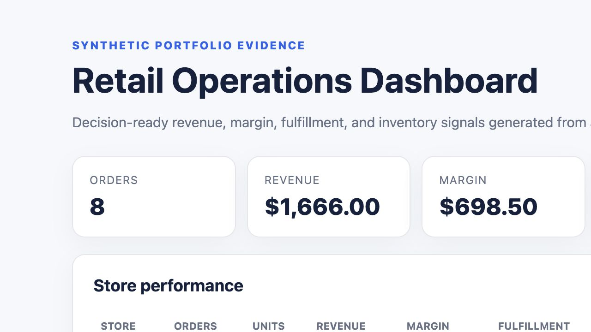
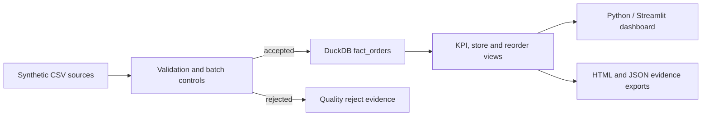
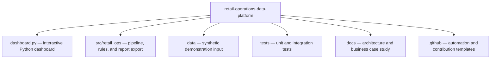

# Retail Operations Data Platform

[](https://github.com/alianisreyesr/retail-operations-data-platform/actions/workflows/ci.yml)
[](https://github.com/alianisreyesr/retail-operations-data-platform/actions/workflows/codeql.yml)


**Data Engineering · Analytics Engineering · Retail Operations · Decision Support**

A production-minded analytics pipeline that converts synthetic retail orders into tested dimensional models and decision-ready inventory metrics.

[Quick start](#quick-start) · [Case study](docs/CASE_STUDY.md) · [Architecture](docs/ARCHITECTURE.md) · [Source](https://github.com/alianisreyesr/retail-operations-data-platform)

> **Data boundary:** Every customer, product, order, and location is fictional. This portfolio project contains no employer, payment, personal, or production data.

## Portfolio preview



The dashboard is generated from the DuckDB decision views; it is not a manually maintained mockup.

## Business outcome

Retail operations teams need one trustworthy view of revenue, demand, inventory pressure, and fulfillment performance. This project demonstrates how raw operational files become quality-checked analytical tables rather than an unreviewed dashboard export.

| Consumer | Decision supported |
|---|---|
| Operations manager | Which stores and products need attention? |
| Inventory planner | Which SKUs are below reorder level? |
| Finance analyst | What revenue and margin were generated? |
| Data team | Did source quality and reconciliation checks pass? |

## What it demonstrates

- Idempotent ingestion keyed on `order_id`: overlapping or re-sent files update orders instead of duplicating them, with a file-hash batch identifier kept as lineage
- Explicit schema and domain validation before loading (missing keys, duplicate `order_id`, truncated rows are rejected with reasons); each run is one transaction
- DuckDB `fact_orders` and `quality_rejects` tables with KPI, store and reorder views
- Revenue, margin, fulfillment, and low-stock metrics
- Store-performance and inventory reorder decision views
- Reject records with human-readable quality reasons
- Run summary (accepted/rejected counts, revenue, margin) and automated tests
- Interactive Streamlit dashboard plus self-contained HTML and JSON evidence exports
- Reproducible CLI execution and CI-ready quality gates

## Architecture



See the [architecture notes](docs/ARCHITECTURE.md) for design decisions and production extensions.

## Quick start

```bash
python -m venv .venv
source .venv/bin/activate
python -m pip install -r requirements-dev.txt   # runtime + pytest, ruff, mypy
python -m pip install -e .
python -m retail_ops.pipeline --input data/orders.csv --database retail_ops.duckdb
python -m retail_ops.report --database retail_ops.duckdb --output reports/operations-dashboard.html
streamlit run dashboard.py
python -m pytest --cov
ruff check . && mypy
```

Expected pipeline summary:

```text
accepted=8 rejected=2 gross_revenue=1666.00 gross_margin=698.50
dashboard=reports/operations-dashboard.html stores=3 reorder_items=4
```

### Docker

```bash
docker compose up --build   # dashboard on http://localhost:8501
```

The image runs as a non-root user and has a health check. The DuckDB file is stored on the `retail_db` named volume (`RETAIL_OPS_DATABASE=/app/db/retail_ops.duckdb`), so it survives container re-creation; `./data` is mounted read-only. Delete the volume (`docker compose down -v`) to rebuild the demonstration database from `data/orders.csv`.

## Repository structure



## Engineering boundary

This is a portfolio implementation, not a hosted production retail platform. Production use would require managed secrets, orchestration, object storage, access controls, observability, data contracts, recovery procedures, and environment-specific cost and performance testing.

## Target roles

Data Engineer · Analytics Engineer · BI Developer · Data Quality Engineer

## Portfolio Ecosystem

Related portfolio projects (synthetic data only):

| Project | Domain Focus | Status |
|---|---|---|
| **[Quality Deviation Risk Monitor](https://github.com/alianisreyesr/quality-deviation-risk-monitor)** | Deviation prioritization & explainable risk scoring | ✅ Active |
| **[CSV Evidence Tracker](https://github.com/alianisreyesr/csv-evidence-tracker)** | Requirements traceability, IQ/OQ/PQ test execution, audit trail | ✅ Active |
| **[GxP Change Control](https://github.com/alianisreyesr/gxp-change-control)** | Controlled change lifecycle & approvals | ✅ Active |
| **[Data Integrity Case File](https://github.com/alianisreyesr/data-integrity-case-file)** | ALCOA+ investigation, CAPA readiness, local AI triage | ✅ Active |
| **[CSA Assurance Planner](https://github.com/alianisreyesr/csa-assurance-planner)** | Risk-based software assurance planning, FDA CSA alignment | ✅ Active |
| **[GxP Batch Data Pipeline](https://github.com/alianisreyesr/gxp-batch-data-pipeline)** | Batch manufacturing pipeline — DuckDB · dbt · quality gates | ✅ Active |
| **[AI Security Analyst](https://github.com/alianisreyesr/ai-security-analyst)** | Deterministic log detection, MITRE ATT&CK mapping, bounded AI summaries | ✅ Active |
| **[Service Operations Command Center](https://github.com/alianisreyesr/service-operations-command-center)** | Incident intake, SLA targets, controlled transitions, audit events | ✅ Active |
| **[AI Document Intelligence Evaluator](https://github.com/alianisreyesr/ai-document-intelligence-evaluator)** | RAG and AI evaluation: citations, recall@k, groundedness | ✅ Active |

---

Built by [Alianis Reyes-Reyes](https://www.linkedin.com/in/alianis-reyes-reyes/).
