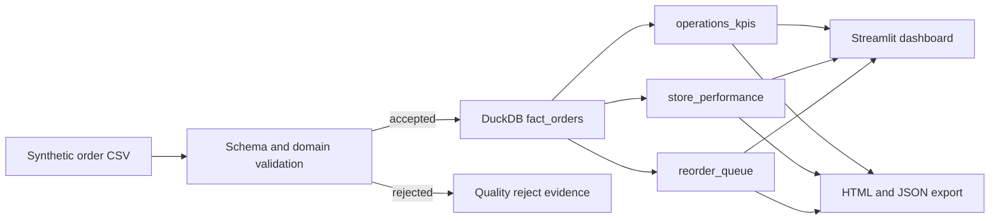
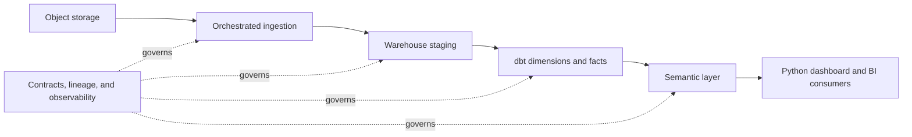

# Architecture decisions

## Why DuckDB

DuckDB provides a reproducible analytical engine without requiring a hosted database. The transformation SQL can later move to a warehouse-oriented implementation.

## Quality contract

Every row must provide the documented columns. Numeric domains reject negative or malformed operational values. Empty `order_id`, `store_id`, `product_id` or `category`, repeated `order_id` within a file, and truncated rows are rejected with explicit reasons. Rejected rows retain the batch identifier, business key when available, and explicit reasons.

## Idempotency

`order_id` is the natural key of `fact_orders`. An order appearing in a later file (overlapping, corrected or extended extracts, or the same file again) replaces its previous row; orders not present in the new file are kept. The input SHA-256 prefix is stored as `batch_id` (lineage) and scopes the reject evidence, which is replaced when the same source is reprocessed. A repeated `order_id` inside one file is rejected as ambiguous. Each run executes in a single transaction, so a failure leaves the database unchanged.

## Production evolution

